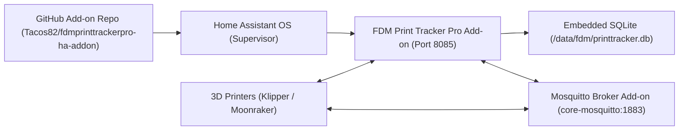
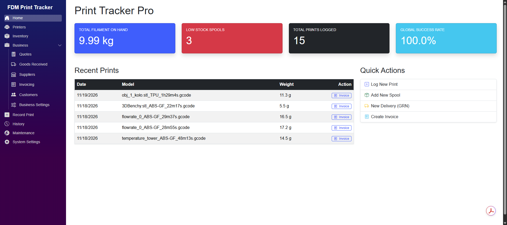
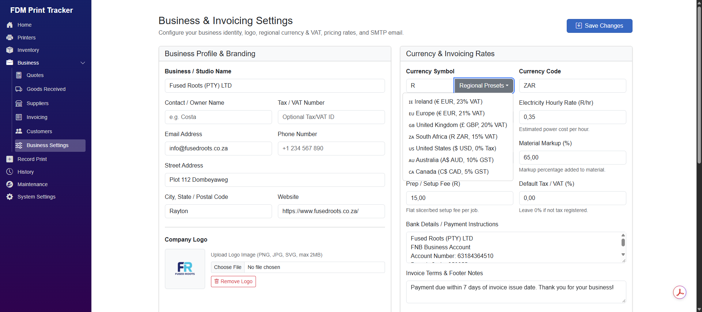
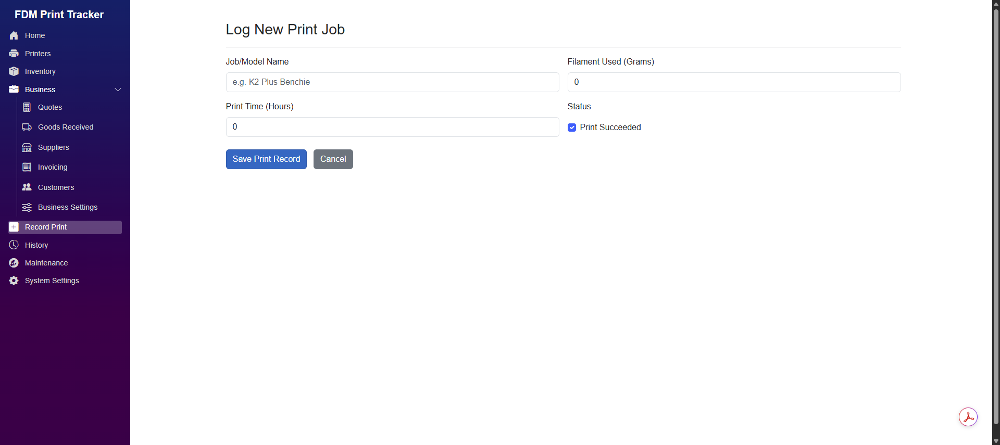

# FDM Print Tracker Pro — Home Assistant OS (HAOS) Install Manual

Install **FDM Print Tracker Pro** directly inside **Home Assistant OS (HAOS)** (Raspberry Pi `arm64` or Mini PC / VM `x86_64`) in just a few clicks—no SSH, no Samba, and no external database server required.

> [!NOTE]
> Everything runs self-contained with embedded **SQLite** stored in `/data/fdm/printtracker.db`, so your data is automatically included in your regular Home Assistant Backups.

---

## Architecture Overview



---

## Step 1: Install the Mosquitto Broker Add-on (If Using MQTT)

1. In Home Assistant, open **Settings → Add-ons → Add-on Store**.
2. Search for **Mosquitto broker** (Official Add-on) and click **Install**.
3. Enable **Start on boot** and click **Start**.

---

## Step 2: Add the FDM Print Tracker Pro Repository

### Option A — 1-Click Install Link (Easiest)
1. Open **https://github.com/Tacos82/fdmprinttrackerpro-ha-addon** in your browser.
2. Click the **"Add Repository"** Home Assistant badge at the top of the page—it opens your Home Assistant Add-on Store with the repository URL pre-filled.
3. Click **Add**.

### Option B — Manual Copy-Paste
1. In Home Assistant, go to **Settings → Add-ons → Add-on Store**.
2. Click the **⋮** (top-right three-dots menu) → **Repositories**.
3. Paste:
   ```text
   https://github.com/Tacos82/fdmprinttrackerpro-ha-addon
   ```
4. Click **Add**, then **Close**.

---

## Step 3: Install, Configure & Start

1. Scroll down in the **Add-on Store** to **FDM Print Tracker Pro Add-ons** and click **FDM Print Tracker Pro**.
2. Click **Install** (this pulls the multi-arch `costa82/fdmprinttrackerpro:latest` image for `amd64` or `aarch64`—allow 1–2 minutes).
3. Open the **Configuration** tab and set:
   - **`tz`**: `Europe/Dublin` (or your local timezone)
   - **`mqtt_broker`**: `core-mosquitto` (default for HA's built-in Mosquitto add-on)
   - **`mqtt_port`**: `1883`
   - **`mqtt_username` / `mqtt_password`**: Leave blank if anonymous, or enter your HA MQTT user credentials
   - **`gemini_api_key`**: *(Optional)* Google Gemini API key for AI Supplier Invoice PDF scanning and Slicer Screenshot → Quote extraction
4. Click **Save**.
5. Go back to the **Info** tab, enable **Start on boot** and **Watchdog**, and click **Start**.

---

## Step 4: Open the Web UI & Select Your Region

1. Click **Open Web UI** (or browse to `http://<home-assistant-ip>:8085`).



2. In the left sidebar, go to **Business → Business Settings**.
3. Click **Regional Presets** and select **🇮🇪 Ireland (€ EUR, 23% VAT)** (or your region), then click **Save Settings**.



4. Add your printers under **Printers**, import filament spools under **Inventory** (with built-in SpoolmanDB lookup), and try **Business → Quotes** to generate quotes from slicer screenshots.



---

## Troubleshooting

- **First startup takes ~15–20 seconds:** SQLite creates `/data/fdm/printtracker.db` and seeds defaults automatically on first boot. Check the add-on's **Log** tab if the Web UI isn't ready immediately.
- **MQTT not connecting:** Confirm the **Mosquitto broker** add-on is running and `mqtt_broker` is set to `core-mosquitto` (or your HA IP address).
- **Updating later:** Whenever a new version is pushed, Home Assistant's **Add-ons** page will show an **Update** button automatically.
